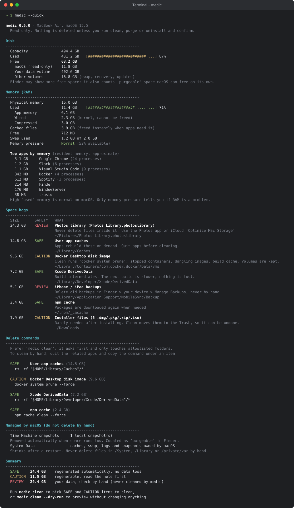
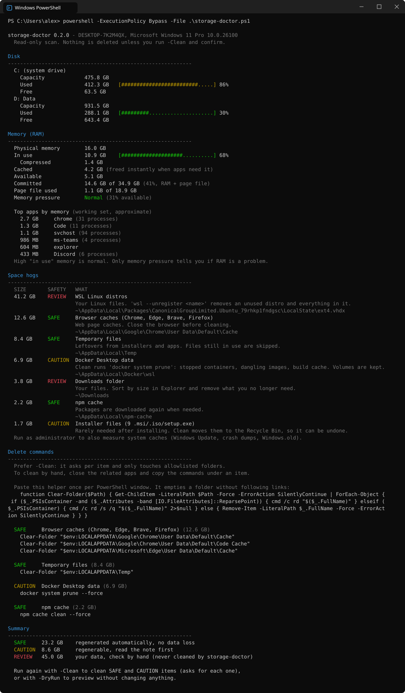

# storage-doctor

See what is filling up your computer, how big it is, and what is actually safe to delete.
Also shows how your memory (RAM) is doing and which apps use the most.

It is **read-only by default**: nothing is deleted unless you ask for a cleanup and confirm every item.
No installation and no dependencies, just one script.

## Which one do I need?

There are two versions.
Pick the one for your computer, they do not work on the other system.

| Your computer | Use this file | Run it with |
| --- | --- | --- |
| **Mac** (macOS 11 or newer) | [`macos/storage-doctor.sh`](macos/storage-doctor.sh) | the **Terminal** app |
| **Windows** 10 or 11 | [`windows/storage-doctor.ps1`](windows/storage-doctor.ps1) | **PowerShell** or **Windows Terminal** |

Not sure what you have?

- If the top-left corner of your screen has an Apple logo menu, you have a **Mac**.
- If you have a Start button with the Windows logo, you have **Windows**.

> [!WARNING]
> Do not run the Mac script on Windows (not even in Git Bash or WSL), and do not run the Windows script on a Mac.
> Each script checks this and stops with a message telling you which file to use instead.

---

## Mac



<sub>Example output with sample data.</sub>

### 1. Download and run

Open **Terminal** (press `Cmd + Space`, type `Terminal`, press Enter) and paste:

```sh
curl -fsSLO https://raw.githubusercontent.com/f-bahesna/storage-doctor/main/macos/storage-doctor.sh
bash storage-doctor.sh
```

Like any script from the internet, you can read it first with `less storage-doctor.sh` (press `q` to quit).

### 2. Options

| Command | What it does |
| --- | --- |
| `bash storage-doctor.sh` | Full report (up to a minute) |
| `bash storage-doctor.sh --quick` | Skip the slow scans (a few seconds) |
| `bash storage-doctor.sh --dry-run` | Walk through the cleanup and show what would happen, change nothing |
| `bash storage-doctor.sh --clean` | Clean SAFE and CAUTION items, asking `[y/N]` for each one |
| `bash storage-doctor.sh --large 2000` | Only list files bigger than 2000 MB |
| `bash storage-doctor.sh --dev-dir ~/work` | Also scan `~/work` for `node_modules` and Python venvs |
| `bash storage-doctor.sh --help` | Show all options |

### 3. Permissions

macOS may ask whether Terminal can access Desktop, Documents, Downloads or data from other apps.
Allowing it gives complete results, declining just leaves those locations out.
Without **Full Disk Access** the Trash and Mail sizes show up empty, and the script tells you so.
You can grant it in System Settings > Privacy & Security > Full Disk Access > Terminal.

Do **not** run it with `sudo`, it refuses to, because it only needs your own files.

---

## Windows



<sub>Example output with sample data.</sub>

### 1. Download and run

Open **PowerShell** (press the Windows key, type `PowerShell`, press Enter) and paste:

```powershell
Invoke-WebRequest https://raw.githubusercontent.com/f-bahesna/storage-doctor/main/windows/storage-doctor.ps1 -OutFile storage-doctor.ps1
powershell -ExecutionPolicy Bypass -File .\storage-doctor.ps1
```

Like any script from the internet, you can read it first with `notepad storage-doctor.ps1`.

Why `-ExecutionPolicy Bypass`?
Windows blocks downloaded scripts by default.
This flag allows **only this one run**, it does not change any setting on your PC.

### 2. Options

| Command | What it does |
| --- | --- |
| `powershell -ExecutionPolicy Bypass -File .\storage-doctor.ps1` | Full report (can take a few minutes) |
| `... -File .\storage-doctor.ps1 -Quick` | Skip the slow scans |
| `... -File .\storage-doctor.ps1 -DryRun` | Walk through the cleanup and show what would happen, change nothing |
| `... -File .\storage-doctor.ps1 -Clean` | Clean SAFE and CAUTION items, asking `[y/N]` for each one |
| `... -File .\storage-doctor.ps1 -LargeMB 2000` | Only list files bigger than 2000 MB |
| `... -File .\storage-doctor.ps1 -DevDir C:\work` | Also scan `C:\work` for `node_modules` and Python venvs |
| `Get-Help .\storage-doctor.ps1 -Detailed` | Show all options |

Note that Windows options start with a single dash and a capital letter (`-Clean`), Mac options with two dashes (`--clean`).

### 3. Administrator mode (optional)

As a normal user the script covers your own files.
To also measure and clean system caches (Windows Update downloads, system temp files, crash dumps, `Windows.old`), run it as administrator.
Right-click the Start button, choose **Terminal (Admin)** or **Windows PowerShell (Admin)**, go to the folder with the script (for example `cd $HOME\Downloads`) and run the same command.
Items that need administrator rights are marked `[admin]` in the report.

---

## What it reports

Both versions show the same sections:

- **Disk**: capacity, used and free space.
- **Memory (RAM)**: memory in use, cache, swap or page file, memory pressure, and the apps using the most memory.
- **Space hogs**: known cache and data locations, each with a size, a safety level and a one-line explanation.
- **Library / AppData breakdown**: the biggest folders inside `~/Library` (Mac) or `AppData` (Windows).
- **Dev dependencies**: `node_modules` and Python virtualenvs in common project folders.
- **Delete commands**: for every SAFE and CAUTION item, the exact command to clean it by hand, if you prefer that over the interactive cleanup.
- **Large files**: the biggest files in your home folder with their last modified date.
- **Managed by the system**: things like Time Machine snapshots, `pagefile.sys` or `WinSxS`, and what to do instead of deleting them by hand.

## Safety levels

| Level | Meaning | Can the cleanup touch it? |
| --- | --- | --- |
| `SAFE` | Regenerated automatically, no data loss (caches, logs, temp files, build output) | Yes, after you confirm |
| `CAUTION` | Regenerable, but you lose more than a cache (stopped Docker containers, locally installed Maven artifacts) | Yes, after you confirm |
| `REVIEW` | May contain your data (Downloads, phone backups, Photos, virtual machines) | **Never**, you get advice instead |

How the cleanup stays safe:

- When a tool has its own cleanup command, that command is used (`npm cache clean`, `go clean -modcache`, `docker system prune`, ...).
- Otherwise only the **contents** of folders on a hard-coded allowlist are deleted, matched exactly.
- Links (symlinks, junctions) are never followed, so a cleanup can never reach outside the allowed folder.
- Installer files are moved to the Trash / Recycle Bin, so you can put them back.
- System folders (`/System` on Mac, `C:\Windows\WinSxS` on Windows) are never touched.

## Good to know

- Sizes match what your system shows: decimal units on Mac (like Finder), binary units on Windows (like Explorer).
- On a Mac, Finder may show more free space, because it counts "purgeable" space macOS frees on its own.
- After a cleanup, the free space can take a minute to update.

## Contributing

Each version keeps its list of locations in one function: `collect_items` in the Mac script, `Initialize-Item` in the Windows script.
Adding a location is usually one line there.
If it can be cleaned by emptying a folder, also add the exact path to the allowlist (`CLEANABLE_DIRS` on Mac, `$cleanable` on Windows).
If the tool has its own cleanup command, add a case to `clean_item` (Mac) or `Invoke-ItemClean` (Windows) instead.
Keep the printed delete commands in sync: `item_commands` (Mac) and `Get-ItemCommand` (Windows) mirror the cleanup functions.
The README screenshots are drawn from the real output of both scripts with made-up data: after changing the report, run `python3 docs/make-screenshots.py` on a Mac with PowerShell 7 installed (CI checks they are up to date).

Before opening a pull request:

- Mac: `shellcheck macos/storage-doctor.sh`, and test with the built-in `/bin/bash` (version 3.2).
- Windows: `Invoke-ScriptAnalyzer windows/storage-doctor.ps1 -Settings windows/PSScriptAnalyzerSettings.psd1`, and test with the built-in Windows PowerShell 5.1.
  Keep the file ASCII only, Windows PowerShell 5.1 misreads other characters.

CI runs all of this on real macOS and Windows machines for every push.

## License

[MIT](LICENSE)
